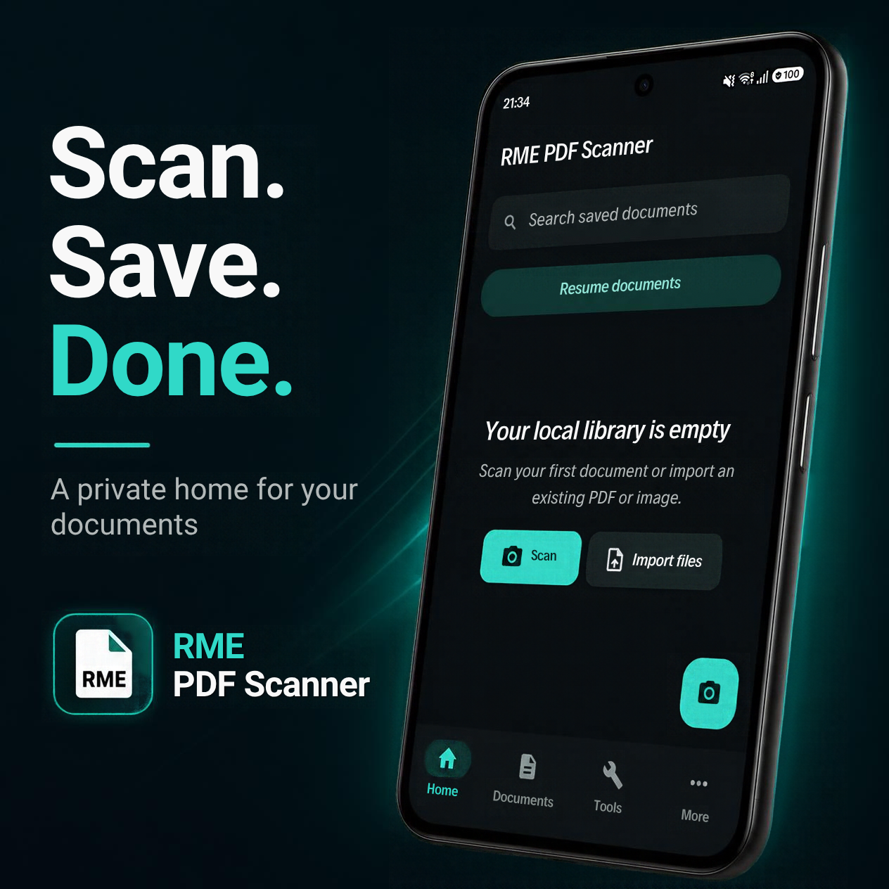
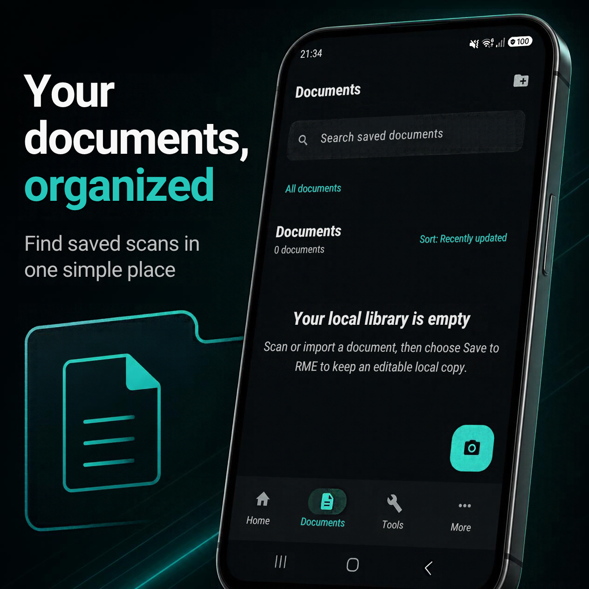
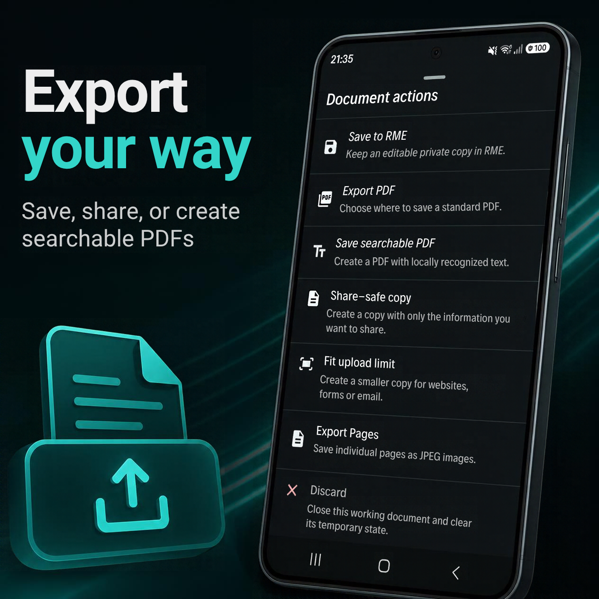
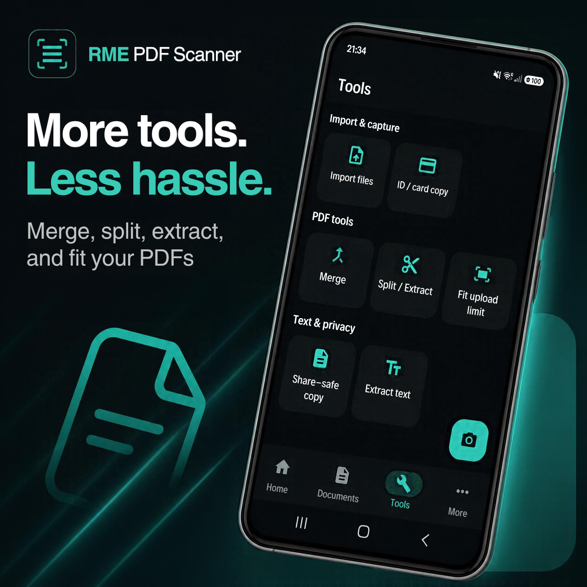
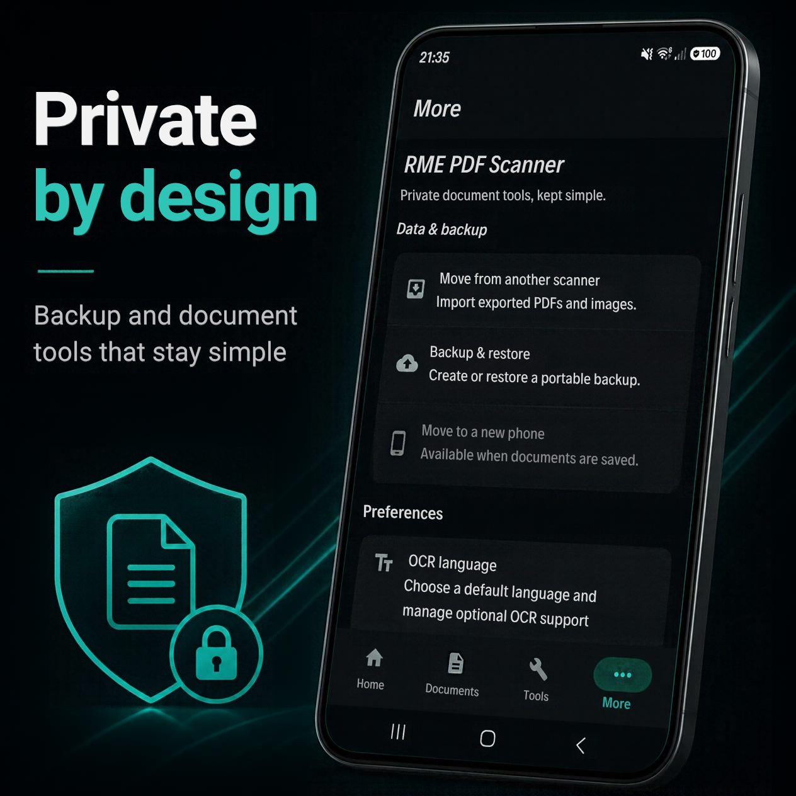

# RME: Private PDF Scanner

Privacy-first, local-first, open-source Android document scanning with multilingual on-device OCR, full-library search, searchable PDFs, safer sharing, portable backup, and no RME account or cloud backend.

[](https://github.com/lucianRME/rme-pdf-scanner)
[](https://github.com/lucianRME/rme-pdf-scanner/releases/latest)

[Google Play](https://play.google.com/store/apps/details?id=org.synapseworks.pageharbor) · [Website](https://synapseworks.org/rme-pdf-scanner/) · [GitBook](https://synapseworks.gitbook.io/synapseworks-docs/) · [Latest release](https://github.com/lucianRME/rme-pdf-scanner/releases/latest) · [Privacy](https://synapseworks.org/rme-pdf-scanner/privacy/) · [Apache-2.0 license](LICENSE)

[⭐ Finding RME useful? Star the repository to help other people discover this privacy-first scanner.](https://github.com/lucianRME/rme-pdf-scanner)

**No ads. No account. No RME analytics or tracking. No proprietary RME backend.** Documents can stay in an app-private local library, and RME itself requests neither the `INTERNET` nor `ACCESS_NETWORK_STATE` permission.

## Screenshots

<p align="center">
  
  
  
</p>
<p align="center">
  
  
</p>

## What you can do

- **Scan and import:** Scan multi-page paper documents; import PDF, JPEG, PNG, or WebP files through Android's system picker; or receive supported files through Android sharing.
- **Recognize and search:** Run on-device Latin OCR or optional Chinese, Japanese, Korean, and Devanagari models delivered through Google Play services. Review and correct text, re-run OCR for one page or a whole document, use batch OCR, search recognized text across the full library, and jump to the matching page.
- **Organize locally:** Keep documents in an app-private local library with folders and subfolders. Rename, move, sort, search, reopen, and use local smart naming without an RME account or cloud service.
- **Edit and export:** Add, reorder, rotate, remove, and enhance pages. Generate searchable PDFs, export PDF or JPEG pages, extract text, and save or share through Android system flows.
- **Use PDF tools:** Merge documents, split or extract pages, and use **Fit Upload Limit** with 200 KB, 500 KB, 1 MB, 2 MB, or custom targets. RME uses readability-aware processing and avoids unnecessary recompression when a document already fits; not every arbitrary limit can be achieved.
- **Prepare Share-Safe copies:** Create a separate copy with destructive blackout redaction, purpose/date watermarking, an optional file-size target, and a final preview before Save or Share. The original remains unchanged.
- **Copy two-sided cards:** Place the front and back of a synthetic or user-provided card on one A4 or Letter page, with zoom/pan review before export.
- **Move existing scans:** Import standard user-exported PDFs and images from other scanner apps, including CamScanner, Adobe Scan / Acrobat, Genius Scan, and Microsoft Lens. RME does not access another app's private storage, database, account, or cloud.
- **Back up and transfer:** Create and restore portable backups, optionally encrypt backup files, and move an RME library to a new phone.
- **Protect app access:** Optionally require Android device authentication when opening RME.

## Install

The current stable GitHub release is **[v1.7.2](https://github.com/lucianRME/rme-pdf-scanner/releases/tag/v1.7.2)**. Google Play is the primary installation method; its publication is handled separately. You can also download the latest stable APK from GitHub Releases or use Obtainium to follow stable GitHub releases. See the [v1.7.2 validation report](docs/releases/v1.7.2-validation.md) for completed checks and deferred coverage.

<p>
  <a href="https://play.google.com/store/apps/details?id=org.synapseworks.pageharbor"></a>
  <a href="https://github.com/lucianRME/rme-pdf-scanner/releases/latest"></a>
  <a href="https://apps.obtainium.imranr.dev/redirect?r=obtainium://app/%7B%22id%22%3A%22org.synapseworks.pageharbor%22%2C%22url%22%3A%22https%3A%2F%2Fgithub.com%2FlucianRME%2Frme-pdf-scanner%22%2C%22author%22%3A%22SynapseWorks%22%2C%22name%22%3A%22RME%3A%20Private%20PDF%20Scanner%22%2C%22additionalSettings%22%3A%22%7B%5C%22includePrereleases%5C%22%3Afalse%7D%22%7D"></a>
</p>

The badge uses Obtainium's third-party hosted redirect for browser compatibility; that redirect page includes analytics and advertising scripts. To avoid the redirect, open Obtainium, choose **Add App**, paste `https://github.com/lucianRME/rme-pdf-scanner`, keep **Include prereleases** disabled, and add the app. Obtainium will follow stable GitHub Releases and select the release APK.

The GitHub APK and Google Play build use different signing certificates, so Android will not install one channel over the other as an update. Before changing installation channels, create a portable RME backup and confirm that you can access it; Android may require the existing installation to be removed, which also removes its app-private document library.

## Privacy

Saved documents, thumbnails, metadata, and optional OCR text live in RME's app-private local library. Recognition and document-content processing run on-device. RME does not operate a backend that receives or stores your documents, require an account, show ads, or run its own analytics or tracking. Exports go to the destination or receiving app you choose through Android's system save and share flows. RME itself requests neither the `INTERNET` nor `ACCESS_NETWORK_STATE` permission.

RME uses Google ML Kit Document Scanner and ML Kit text recognition; these Google components are not part of RME's open-source code. Latin recognition is bundled with the app. Optional Chinese, Japanese, Korean, and Devanagari OCR models, as well as scanner resources, may be downloaded or updated by Google Play services. Recognition runs on-device after the required model is available. ML Kit may send technical diagnostics under Google's practices. This is not a promise that every system component works without network access. Read the [full privacy policy](https://synapseworks.org/rme-pdf-scanner/privacy/) and [third-party notices](THIRD_PARTY_NOTICES.md).

## Open source and development

The app is written in Kotlin with Jetpack Compose and Material 3. Its local library and search use Room/FTS; document workflows use Android system pickers and sharing, Google ML Kit, and PdfBox Android. RME's source is Apache-2.0 licensed; not every dependency is open source. See the [architecture overview](docs/ARCHITECTURE.md) for more detail. Minimum Android API level: 26; target API level: 36.

To build from source, use JDK 17 and an Android SDK with API 36. The repository includes the Gradle 8.14.3 wrapper and uses Android Gradle Plugin 8.13.0; use an Android Studio version that supports that toolchain.

```sh
git clone https://github.com/lucianRME/rme-pdf-scanner.git
cd rme-pdf-scanner
./gradlew assembleDebug
```

The debug APK is written to `app/build/outputs/apk/debug/`. Release signing credentials are not included in the repository; see [release-signing guidance](docs/RELEASE_SIGNING.md) for local verification and release builds.

## Discover RME

<a href="https://alternativeto.net/software/rme-pdf-scanner/about/?utm_source=badge&amp;utm_medium=referral">
  
</a>

## Contributing and support

[Issues and feature requests](https://github.com/lucianRME/rme-pdf-scanner/issues) and code contributions are welcome. Please do not attach sensitive documents to reports or test materials.

Visit [SynapseWorks](https://synapseworks.org/) or its [support page](https://synapseworks.org/support/). For public support, email [support@synapseworks.org](mailto:support@synapseworks.org); for security issues, email [security@synapseworks.org](mailto:security@synapseworks.org).

RME: Private PDF Scanner was formerly known as **PageHarbor** and **RME: PDF & Document Scanner**. The Android application ID remains `org.synapseworks.pageharbor` for upgrade compatibility.

## License

RME PDF Scanner is licensed under the [Apache License 2.0](LICENSE).

The Apache License 2.0 applies to the RME source code. The RME, RME PDF Scanner, and SynapseWorks names and associated logos, icons, and brand identity are not granted for use as branding for derivative applications under that license. Forks may accurately describe their origin but should use their own product identity. See [TRADEMARKS.md](TRADEMARKS.md).
